# LED-MERKKI
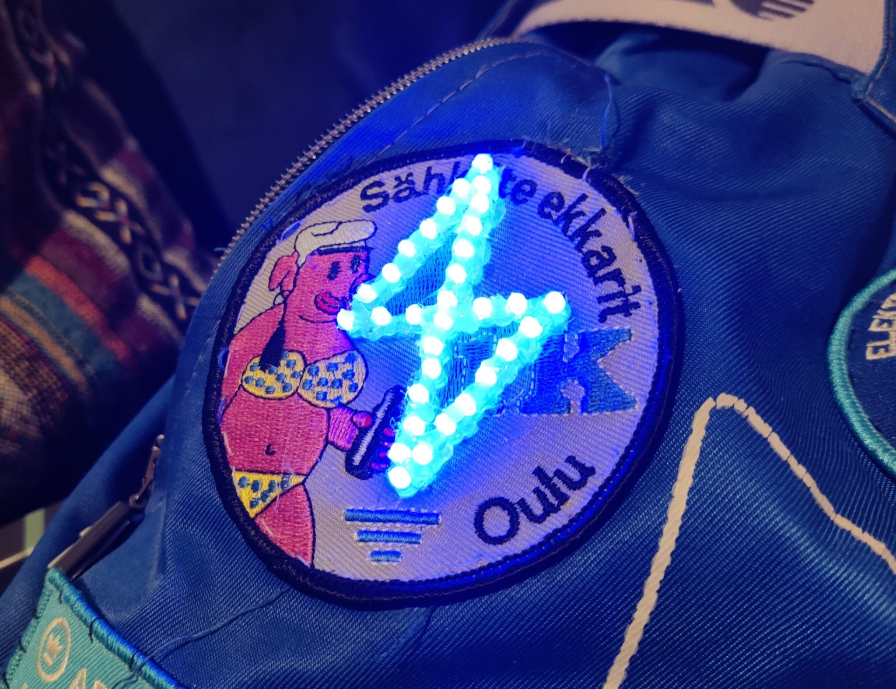


## Mistä koostuu ja miten se toimii
Salaman mikrokontrolleri (mcu) ohjaa ledejä sytyttäen niitä yksi kerrallaan hyvin lyhyeksi aikaa.
Ledit ovat multiplexattu (4x8 LED), ja kytketty yhdellä vastuksella per rivi.

Levyyn on myös suunniteltu kytkin, jolla voisi vaikka sammuttaa laitteen tai toimittaa muuta toiminnallisuutta, mutta näitä ei ole koodissa toteutettu vieläkään.

Kuusipinninen liitin on ohjelmointia varten ja sitä kautta ohjelma siirretääm mikrokontrollerille.
Ohjelmointi hoituu Arduinon ISP:n kautta.

## Skeema
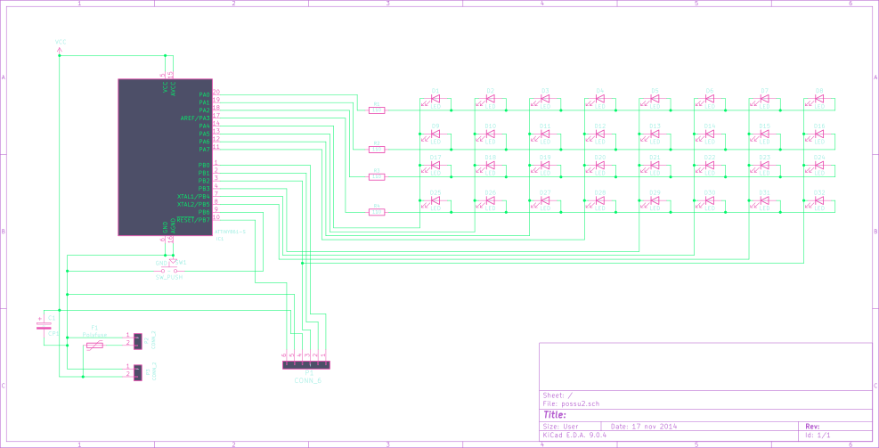

## Osaluettelo
<!--
  * 1 kpl  ATtiny861a SOIC
  * 32 kpl 3 mm diffusoitu LED
  * 1 kpl  10 µF SMD tantaalikondensaattori
  * Kuusi pinnisen piikkiriman ohjelmointia varten.

  **Riippuen LEDien väristä:**
  * Siniset/valkoiset/vihreät:   4 kpl 110 Ohm 1206/1210 SMD-vastus
  * Punaiset/keltaiset:          4 kpl 150 Ohm...
  
  **lisäksi tarvitset:**
  * kuumaliimaa
  * USB kaapelin
  * Extra vastuksen? Selivä myöhemmin...
  * haalarimerkin :-)
-->

| **Komponetti** | **KPL** | **Huomautukset** |
| :--- | :--- | :--- |
| ATtiny861a SOIC | 1 |  |
| 3 mm diffusoitu LED | 32 | |
| 110 Ohm 1206/1210 SMD vastus | 4 | Sinisille, valkoisille, vihreille ledeille |
| 169 Ohm 1206/1210 SMD vastus | 4 | Keltaisille, punaisille ledeille |
| 10 µF SMD tantaalikondensaattori | 1 | |
| 6 pinnisen piikkirima | - | Ohjelmointia varten |
| Kuumaliimaa | - | Ledien suojaamiseen |
| USB kaapeli | - | Sopivan pituinen, vaikka 1 m |
| Haalarimerkki | 1 | :-) |

<!---
| **Komponetti** | **KPL** | **Huomautukset** |
| :--- | :--- | :--- |
| ATtiny861a SOIC | 1 | S/SU |
| 3 mm diffusoitu LED | 32 | |
| 10 µF SMD tantaalikondensaattori | 1 | |

| **Vastuksets** | **KPL** | **Huomautukset** |
 :--- | :--- | :--- |
| 110 Ohm 1206/1210 SMD vastus | 4 | Sinisille, valkoisille, vihreille ledeille |
| 150 Ohm 1206/1210 SMD vastus | 4 | Keltaisille, punaisille ledeille |
| | | | 

| **Lisäksi tarvitset** | |
 :--- | :--- |
| 6 pinnisen piikkirima | ohjelmointia varten |
| Kuumaliimaa | Ledien suojaamiseen |
| USB kaapelin | Sopivan pituinen |
| Haalarimerkin  | :-) |
--->
  
## Pirilevyt 
| [SIK](kicad/possu) | OTiT | [YRK](kicad/ymp) | [PROSE](kicad/prose) | [KONE](kicad/kone) | [ARK](kicad/ark) | [OPTIEM](kicad/optiem) |
| :---: | :---: | :---: | :---: |  :---: |  :---: |  :---: |
|  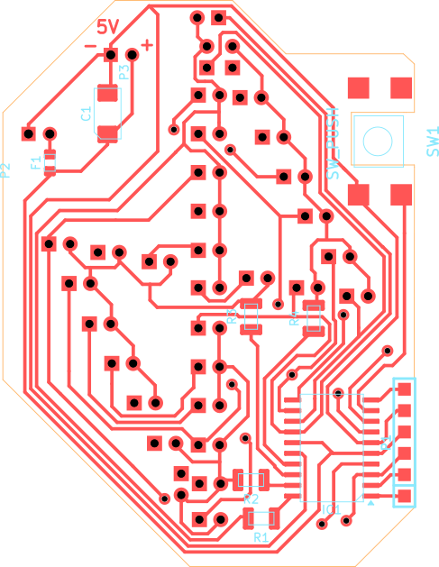 | 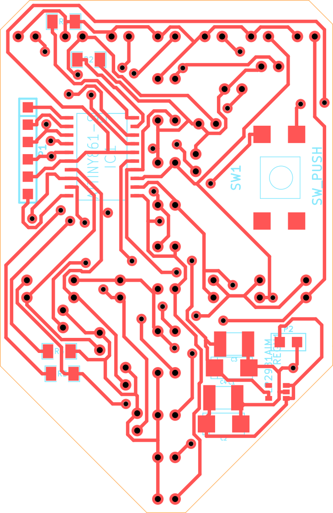  | 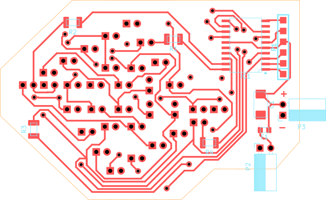  | 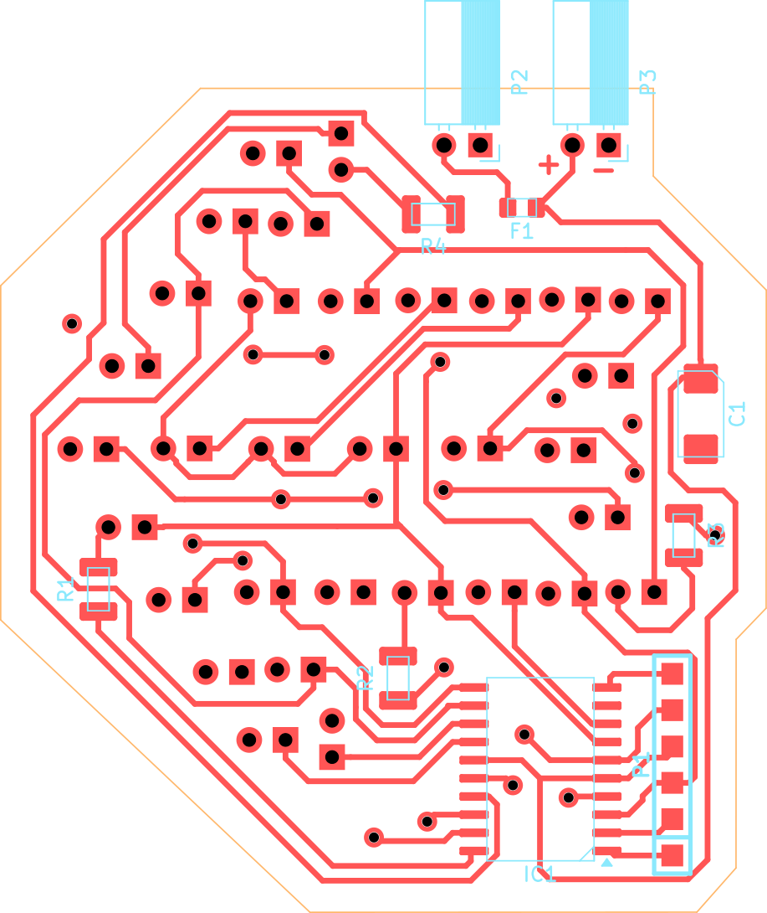 | 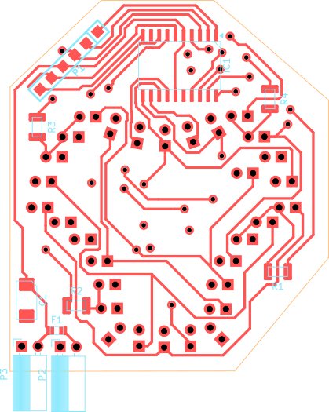 | 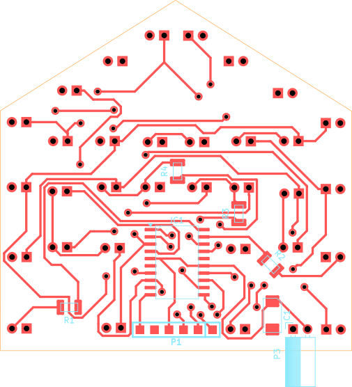 | 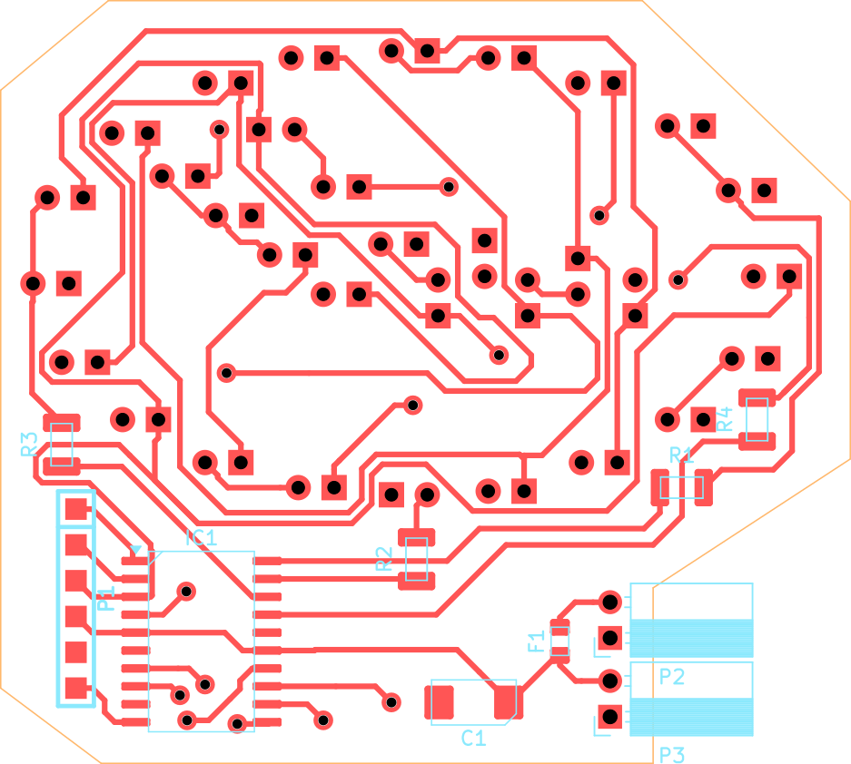 <tr></tr>
| 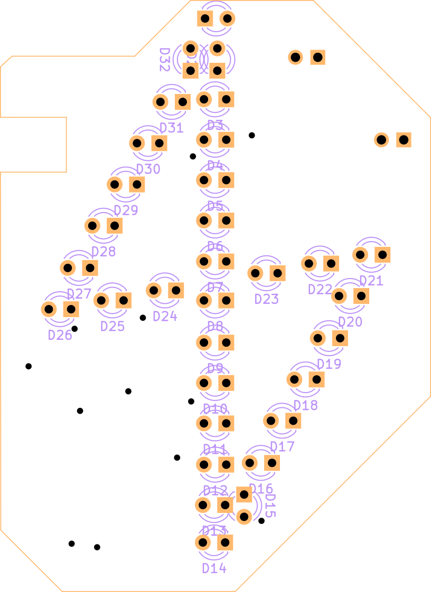 | 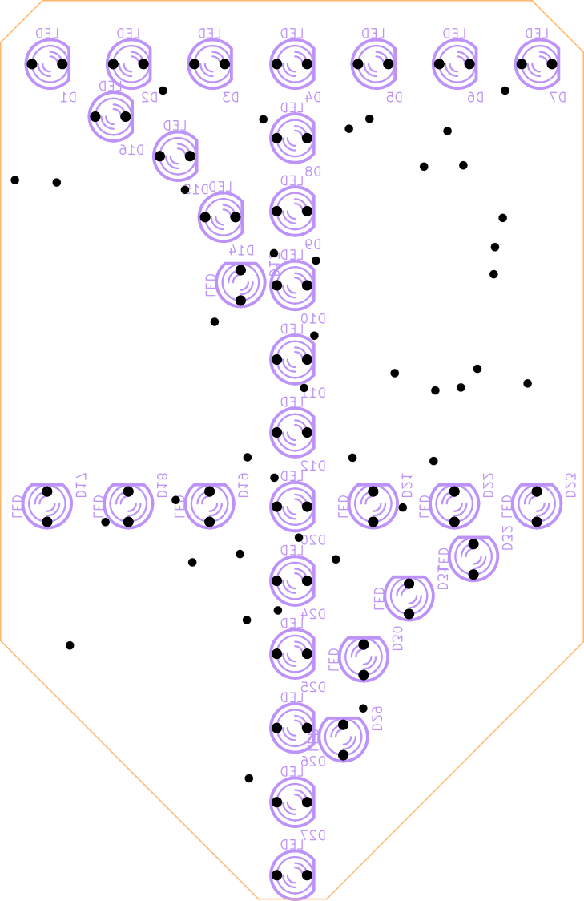 | 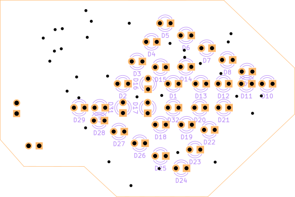 | 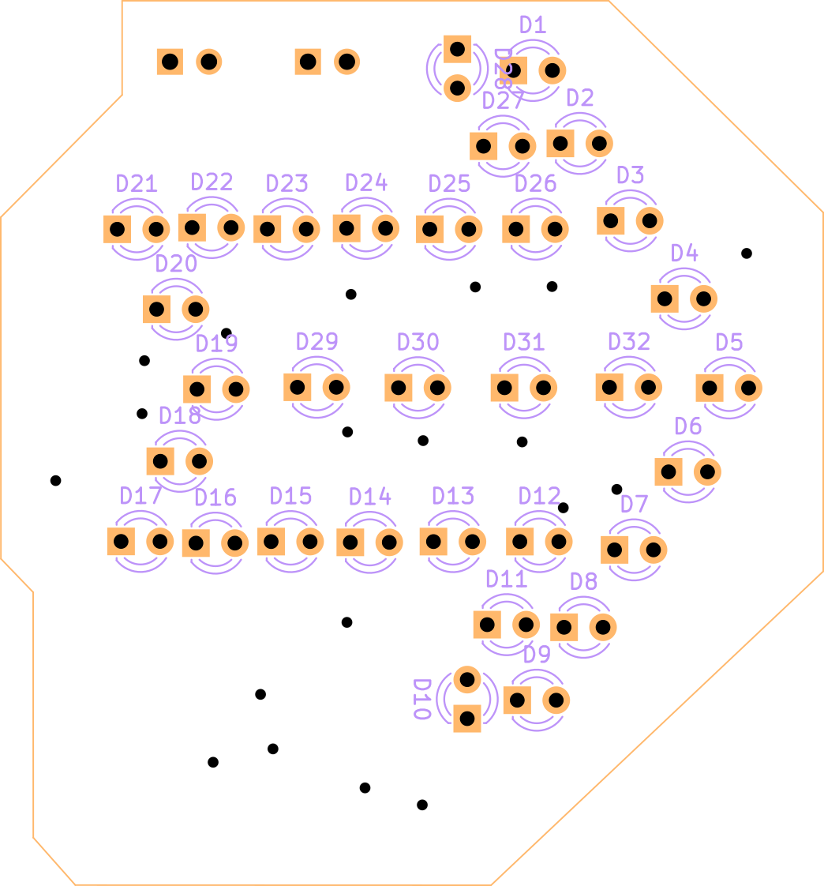 | 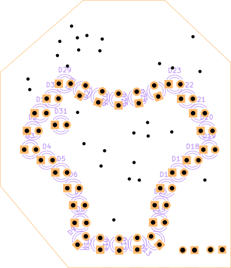 |  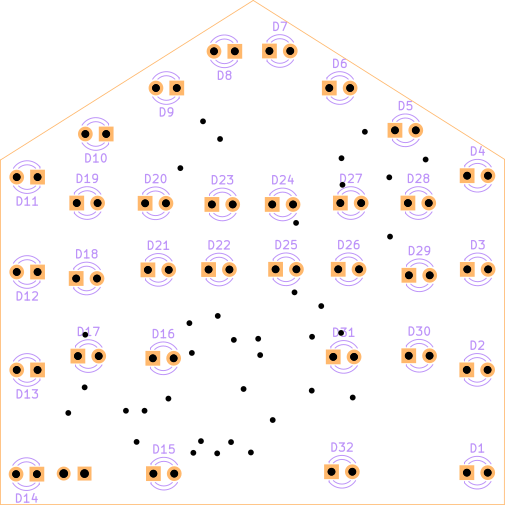 | 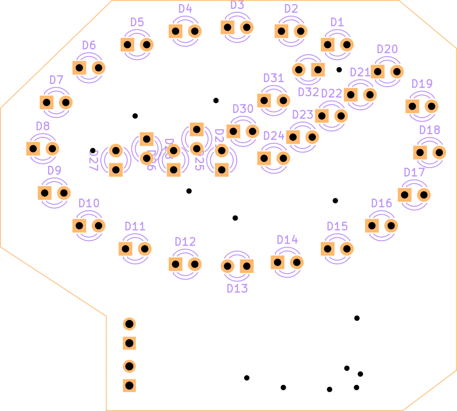
<!---| 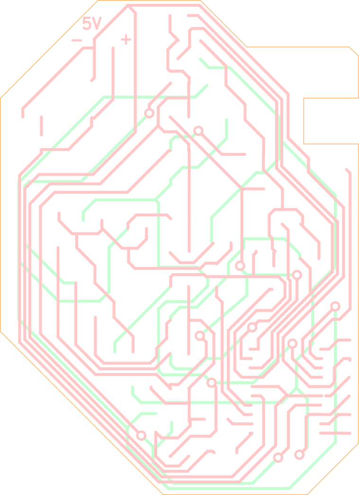  |   |   |   | | | <tr></tr> --->


<!-- ## Ohjeet piirilevyn tekoon -->
<!-- <details> -->
<!-- <summary><b>Näytä </b></summary> -->
<!-- Tee vaikka syövyttämällä tai jyrsimällä :D -->
<!-- </details> -->

# Ohjeet kokoonpanoon

Nyt kun sinulla on piirilevy, laitetaampa siihen komponentit kiinni.

## 1. Pintaliitos komponentit

Piirilevyyn juotetaan 4 SMD vastusta, 1 SMD kondensaattori ja 6-pinninen piikkirimai.  
Helpointen ja nätein tapa juottaa ne on laittamalla yhteen pädiin vähän tinaa ja sitten     varovasti työntää komponetti sulaneseen tinaan, niin ettei se jää "ilmaan".  
Toinen puoli on helpompi juottaa kun se nyt pysyy siinä paikallaan.

Vastuksilla ei ole väliä kummin päin ne on laitettu, kuhan numero puoli on ylöspäin ja suhteellisen suoraan laitettu, se on hyvä.
Kondensaattorin suunta pitää kattoa leiskasta.

Piikkiriman juottaminen onnistuu samalla tavalla, paitsi nyt joudut pitämään sitä vähän ilmassa,  
jotta saat sen kunnolla juotettua kiinni.
   
 
## 2. Piiri 
Piirin juottaminen onnistuu helpointen siten, että juotat ensin yhden kulmajalan kiinni.  
Sulata juotos, jos piiri on vinossa.
Tarkista, että piirin kaikki jalat ovat pädien päällä. Ei ilmassa.  
Juota sitten toinen vastakkainen kulmajalma.

Loput jalat voi juottaa yksi kerrallaan.  
Tai jos haluaa kokeilla nopeammalla tavalla niin veto juottamalla saa yhden puolen yhdellä vedolla*. 
[Esimerkki video...](https://www.youtube.com/results?search_query=drag+soldering)

## 3. Virtajohto
USB kaapelista pitää leikata toinen pää pois.  
Kuori 5v and GND johdot joko saksilla tai kuorimilla.  
Juota sitten 5V ja GND piirilevyyn.

Tähän kannattaa käyttää USB-kaapelia, jossa on vain 5V ja GND.   
Tai sellaista kaapelia jossa on paksut sisäiset johtimet.

   
## 4. Ledit

Ledien juottaminen on suurin työmaa merkin valmistuksessa.  
Työtä aiheuttaa lähinnä ledin painaminen merkistä läpi. Ensin pitää huomioida polariteetti.  
Jos olet nähnyt paljon vaivaa että olet laittanut ledit miten sattuu niin voipi harmittaa..

**Pidä mielessä:**  
Pyöreä läpiveto ja pidempi jalka ledissä = POS  
Neliö läpiveto ja lyhyempi jalka ledissä = NEG

Ledien jalkojen päät kannattaa katkoa kulmassa, näin niistä tulee teräviä. Helpottaa ledien painamista merkistä läpi.
Toinen kikka on myös paksummalla neulalla tehä reikiä etukäteen.

Jos jostakin syystä, olet juottanut kaikki ledin väärin päin.  
Erinomaista, homma meni pieleen.  
Onneksi on olemassa toinen koodi tiedosto joka vaihtaa ledien logiikan.
   
## [5. Hyppää kohtaan "Ohjelmointi"](#ohjelmointi)
   
## 6. Piikkiriman poisto
Sitten kun ohjelmisto on flashatty ja tarkistettu, että kaikki ledit toimiii niinkuin pitäisi, piikkirima otetaan pois. Joko imusukkaa / tinapumppua käyttäen tai sitten lämmittämällä kaikki joloissa olevat tinat kolvilla, tekemällä vetoliikkeitä.
    
## 7. Kuormavastus 
Tässä kohtaan on hyvä kokeilla laittaa merkki powerbankkiin kiinni.

Jos merkki sammuu itsestään, se voi hyvinkin johtua siitä, että merkki on liian energiatehokas :D
Esim. SIK:in possu merkki syöpi n. 5-20 ma riippuen ledien tilasta.

Tämän ongelman saa korjattua juottamalla kuormavastuksen 5V ja GND väliin.  
Esim. Juottamalla 110 ohmin vastuksen, merkki syö ~60 ma.  
Tarvittava kuormavastus riippuu käyttämästäsi varavirtalähteestä.  
Niissä on vaihteleva minimivirranvaatimus, jonka alittaessa ne katkaisevat virransyötön.
    
## 8. Viimeistely
Lopuksi, laita kuumaliimaa ledien ympärille suojausta varten.  
Ei ole pakko jos et halua.

Mutta siinähän ois ***komia*** merkki valmiina.  
Ei muuta ku ompelemaan kiinni!!  
🥳 🧵 🪡

<!-- </details> -->


# Ohjelmointi

Tähän tarvitset Arduino nanon tai unon, jotta saat siirrettyä koodit levylle.

Koodin kääntämiseen tarvitset avr-gcc ja koodin siirtämiseen avrdude.  
Eli asenna omalle käyttöjärjestelmälle kyseiset työkalut, ennen seuraavia kohtia.

## 1. Ohjelmoinin setuppaus
Aletaanpa pukata sitä koodia, että merkkistä tulisi valoa.  
Mutta ensin pitää hyppyjohdoilla tehdä yhteys led-merkkiin.

Käytetään Arduino nanoa tässä esimerkissä:

| Merkin pinni | 1 | 2| 3 | 4 |5 |6 |
| :---: | :---: | :---: | :---: | :---: | :---: | :---: |
| *Selite* | *MOSI* | *MISO* | *SCK* | *VCC* | *GND* | *Reset* <tr></tr> |
| **Arduinon pinni** | **D11** | **D12**| **D13** | **VCC** | **GND** | **D10** | 

(Leiska kuvasta näkee liittimessä neliön --> 1. pinni)

Muista vetää arduinon Reset ylös. Ardu nollautuu kun sarjaliikenne alotetaan....

## 2. Ledien suunta logiikan flippaus
Mikäli olet juottanut ledit väärinpäin, eikä niiden irroittaminen ja uudelleen juottaminen huvita,  
voit muuttaa ledien ohjaavan logiikan ennen kääntämistä.
      
**Tiedosto: led-merkki/src/vilkutus.c**  
(rivit 6-7):

```c
#include "lediportit.h"             // Mikäli juotit ledit väärin päin,
// #include "lediportit_vaarin.h"   // Vaihda tästä otsikko tiedosto.
  ```
Ledit väärinpäin: 
```c
// #include "lediportit.h"             // Mikäli juotit ledit väärin päin,
#include "lediportit_vaarin.h"   // Vaihda tästä otsikko tiedosto.       
```

## 3. Koodin kääntäminen

   
```bash
# Kääntäminen käyttäen avr-gcc:tä
avr-gcc -mmcu=attiny861 salama.c -I./ -Os -DF_CPU=8000000UL
```

  Jos et saa koodeja käännettyä,  pre_compiled hakemistosta löytyy valmiiksi käännetyt koodit. 
    
## 4. Ohjelman siirto levylle 

#####  Unix-like

```bash
# Fläsäys käyttäen arduino-isp:tä
avrdude -c avrisp -p t861 -B3 -P /dev/ttyUSB0 -b 19200 -U flash:w:a.out

# Fuse asetukset käyttäen arduino-isp:tä
avrdude -c avrisp -p t861 -B3 -P /dev/ttyUSB0 -b 19200 -U lfuse:w:0xe2:m -U hfuse:w:0xdf:m
```
Jos valittaa oikeuksista, vedä sudo/doas tilassa.

Jos siirtämisen aikana tulee "programmer not responding",  
kokeile toista baudratea tai ottamalla "-B3" pois.

##### Windows

```bash
# Fläsäys käyttäen arduino-isp:tä
avrdude -c avrisp -p t861 -P COM3 -b 19200 -U flash:w:a.out

# Fuse asetukset käyttäen arduino-isp:tä
avrdude -c avrisp -p t861 -P COM3 -b 19200 -U lfuse:w:0xe2:m -U hfuse:w:0xdf:m

```
Windowsilla avrdude pitää olla ympäristömuuttujissa.  
Toinen vaihtoehto on ajaa komento "\Arduino\hardware\tools\avr\bin"-kansiossa.

Jos siirtämisen aikana tulee error,  
kokeile toista baudratea tai lisäämällä "-B3" kuten Unix-like komennoissa.


## [5. Hyppää kohtaan "Piikkiriman poisto"](#6-piikkiriman-poisto)
